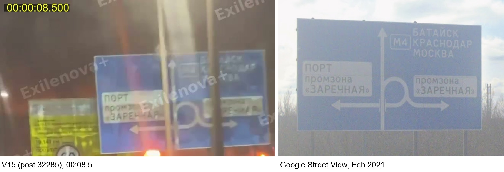
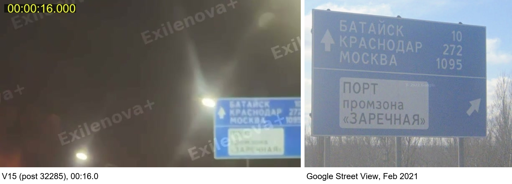
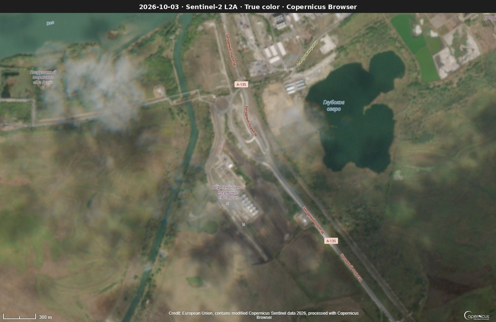
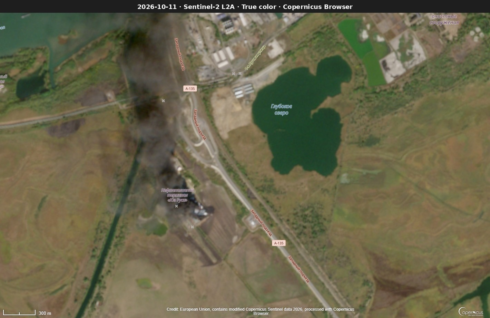
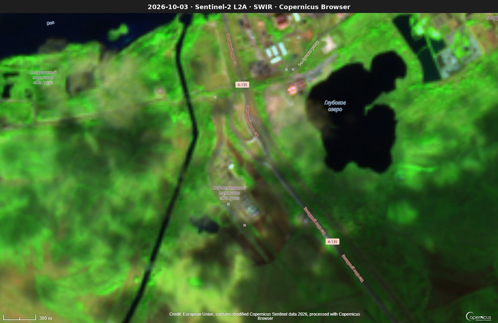
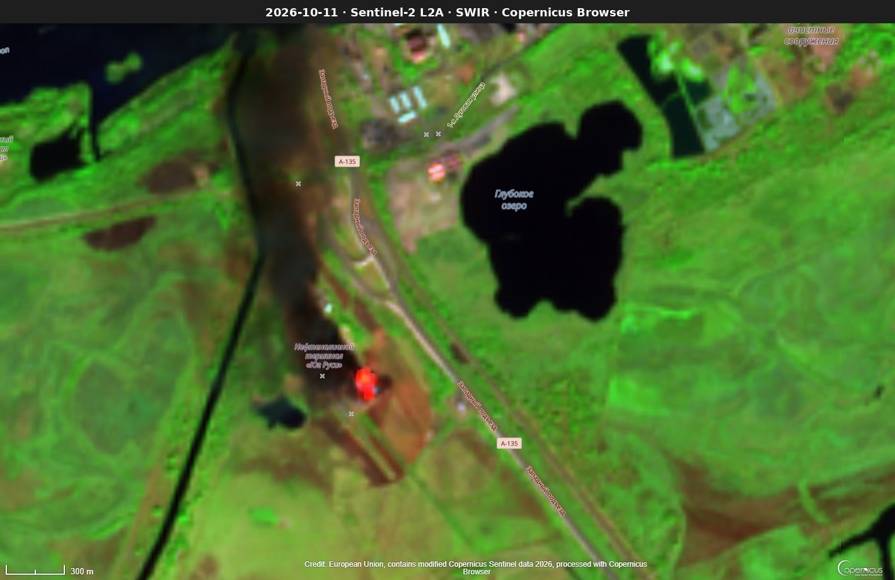
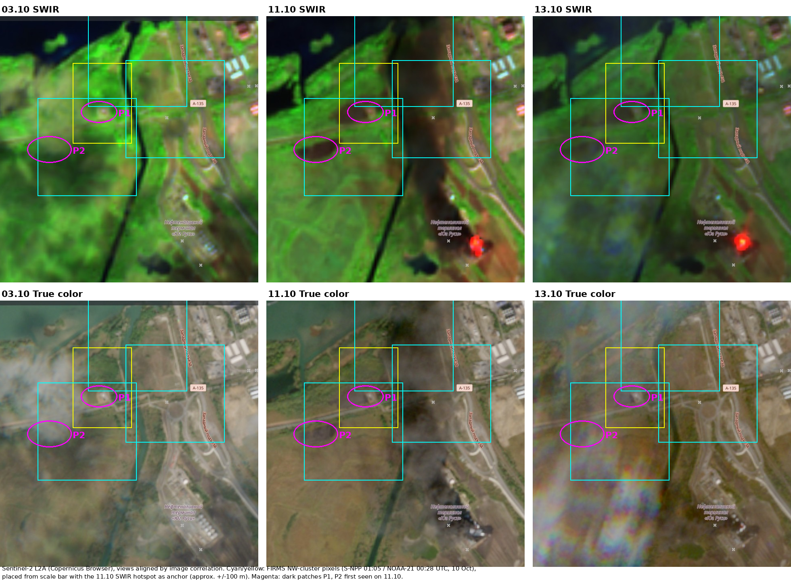

# Fire at the NZNP oil terminal, Rostov-on-Don, night of 9–10 October 2026
### An open-source verification

**Author:** Bohdan Yakovliev · **Date:** 15 October 2026 · **Status:** v1.0

---

## 1. Key findings

- **On the night of 9–10 October 2026 a fire started at the oil-loading terminal in Rostov-on-Don.** The first videos appeared in Telegram channels at 23:25 UTC, and the first satellite heat detection came at 23:44 UTC. On 11 and 13 October the fire was still burning. *Confidence: high.*
- **The places in the videos match the maps**: V15 by two road signs, V19 to a sector of the right bank (a candidate building is withheld to protect the filmer). *Confidence: moderate to high.*
- **The operator in the state register is JSC NZNP.** Its management company also manages Rosewood Shipping, which is itself sanctioned and manages vessels under sanctions. Who stands behind the management company is not confirmed.
- **Floodplain:** on the first night, reeds burned briefly 1–1.6 km NW of the terminal. Two satellites and burn scars on Sentinel-2 support this. *Confidence: moderate.*
- **Not verified:** the media claim that 7 of 12 tanks burned.

## 2. Scope and questions

This report checks the claims made on the night of 9–10 October 2026 about a fire at an oil facility in Rostov-on-Don:

1. Did a fire happen, and where exactly?
2. When did it start and how long did it last?
3. What is the facility, and who owns or manages it?
4. Can the published footage be tied to this facility?
5. Which media claims hold up?

Out of scope: who carried out the attack and with what.

## 3. Sources and method

**Collection.** 21 files (videos and photos, V01–V21) from posts 32270–32299 of the Telegram channel exilenova_plus, posted 9 Oct 23:25 UTC – 10 Oct 02:50 UTC. Collected passively with a research account. Post times in UTC were taken from the post's `<time datetime>` attribute (`?embed=1` view). All files come from this one channel because of time limits; tracing the earliest posts in other channels is the next step.

**Chain of custody.** Every file has a SHA-256 hash, post time (UTC), collection time (UTC) and logging time (UTC) in `data/sources.csv`. Originals in `raw/` were never edited; all work was done on copies.

**Tools.**

| Task | Tool |
|---|---|
| Frame extraction with timestamps | ffmpeg (`scripts/frames.py`) |
| Side-by-side comparisons | Python/Pillow (`scripts/compare.py`) |
| Street-level imagery | Google Street View, Yandex Panoramas (most recent imagery: Feb 2021) |
| Very-high-resolution imagery | Google Earth (imagery 7 Sep 2025) |
| Thermal anomalies | NASA FIRMS (VIIRS S-NPP, NOAA-20, NOAA-21; MODIS) |
| Before/after imagery | Sentinel-2 L2A via Copernicus Browser (true colour, SWIR) |
| Company records | checko.ru (Russian state register data) |
| Sanctions | OpenSanctions |
| Bearings, distances, view-angle check | Python (haversine, pinhole camera model) |

An AI assistant (Claude) was used for scripting and calculations; collection, geolocation decisions and conclusions are the author's.

## 4. The facility

- **Site:** oil-loading terminal at 1-ya Lugovaya St. 50, Zarechnaya microdistrict, left bank of the Don, Rostov-on-Don, next to the Western approach road (A-135).
- **Tank farm centre:** 47.16591, 39.64078 (Google Earth, imagery 7 Sep 2025). The Google Maps pin (47.166, 39.643) sits ~170 m east of the tanks; all bearings use the tank farm centre.
- **Name:** OpenStreetMap still labels the site "Нефтеналивной терминал «Юг Руси»". DW and The Moscow Times describe it as the NZNP oil-loading terminal "formerly called Yug Rusi". A separate "Погрузочный терминал «Юг Руси»" (loading terminal) is labelled on the Don bank ~2 km to the NW. Whether it is linked to the oil terminal was not checked.
- **Operator:** in the state register this address is the "Rostovsky" branch of **JSC NZNP** (Novoshakhtinsk Oil Products Plant), INN 6151012111, active. Next door (No. 52): NZNP's "Avtokolonna" (vehicle fleet) branch.
- **Management:** since 2020, NZNP is run by a managing company, **JSC NZNP Management** (INN 9725007881). Shareholders are not disclosed in the register.
- **Group links:** NZNP Management also manages NZNP Trading House, Yugtrans-NZNP LLC and **Rosewood Shipping LLC** (INN 6167088540).
- **Sanctions:** Rosewood Shipping is sanctioned by Ukraine (NSDC, since 2022). Per OpenSanctions it is listed as commercial and/or security manager of six sanctioned vessels, including *Sanar 7* (managed since 2013; sanctioned by the US, UK, EU, Switzerland and Canada) and *Sanar 18* (since 2023; EU, Switzerland, Canada).
- **Context:** the NZNP refinery itself in Novoshakhtinsk was reported attacked in December 2024 ([Euromaidan Press](https://euromaidanpress.com/2024/12/19/drones-strike-last-operational-oil-refinery-in-russias-rostov-oblast/)) and on 25 August 2026 ([IStories](https://istories.media/news/2026/08/25/novoshakhtinskii-npz-ostanovil-rabotu-posle-ataki-bpla/)).

**Why it matters:** the terminal belongs to a group that also manages vessels under sanctions, which links it to the export of oil products by sea.

## 5. Timeline (UTC)

| Time (UTC) | Event | Source |
|---|---|---|
| 3 Oct | Terminal intact: block of light round tanks visible | Sentinel-2 |
| 9 Oct 23:25 | First post in the series (32270) | Telegram |
| 9 Oct 23:44 | First thermal detection at the terminal (VIIRS NOAA-20, 2 pixels) | FIRMS |
| 10 Oct 00:28 | 4 detections, total FRP ~104 MW; 1 of them 1.4 km NW | FIRMS (NOAA-21) |
| 10 Oct 01:05 | 9 detections, total FRP ~106 MW; 3 of them 1.1–1.6 km NW | FIRMS (S-NPP) |
| 10 Oct 02:50 | Last post in the series (32299, V19) | Telegram |
| 10 Oct 10:13–11:13 | Peak: ~141–146 MW total FRP | FIRMS (NOAA-21, NOAA-20) |
| 11 Oct (daytime overpass) | Active fire on the tank block (SWIR), dense smoke plume to N/NW | Sentinel-2 |
| 11 Oct | Low FRP (≤25 MW) | FIRMS |
| 12 Oct 17:34 | Last detection in the FIRMS data, which was downloaded on 13 Oct (MODIS, ~10 MW) | FIRMS |
| 13 Oct (daytime overpass) | Active fire still visible on the tank block (SWIR) | Sentinel-2 |

**Baseline:** no FIRMS detections at this location 2–8 October or before 23:44 UTC on 9 October.

Note: in the FIRMS map, the date picked in the calendar is the **end** of the period shown.

## 6. Geolocation

### 6.1 V15 — post 32285: road signs on the Western approach

The camera is in a vehicle driving south towards the terminal. Two road signs match Street View (Feb 2021):

| Landmark | Frame | Location | Match |
|---|---|---|---|
| L1, junction diagram sign | 00:08.5 | 47.1749, 39.6419 | layout matches |
| L5, distance sign "Bataysk 10 / Krasnodar 272 / Moscow 109[5]" | 00:16.0 | 47.1742, 39.6423 | text and layout match |

- Order of the signs along the road matches the direction of travel. The exit to the right, via a loop to the Zarechnaya industrial zone, is on Yandex Maps.
- Discrepancies: speed limit 40 on 2021 imagery vs 60 in the video (sign replaced since 2021?); the last digit of "Moscow 109x" is cut off by the frame edge.

*Figure 1. V15 (Telegram, exilenova_plus, post 32285), frame 00:08.5, junction diagram sign L1, compared with Google Street View (Feb 2021) at 47.1749, 39.6419.*

*Figure 2. V15, frame 00:16.0, distance sign L5 "Bataysk 10 / Krasnodar 272 / Moscow 109[5]", compared with Google Street View (Feb 2021) at 47.1742, 39.6423.*

**Assessment:** high confidence. Both signs and their order along the road match; the speed-limit difference (40 vs 60) is explained by the Street View imagery being from 2021.

### 6.2 V19 — post 32299: bridge and fire at night — sector, not building

- Frame: elevated view; lit road on the near bank, bridge with lights over water (reflections visible), fire beyond the far bank to the right of the bridge.
- Bridge: the Don bridge on the Western approach, north end 47.18569, 39.63756; south end 47.18124, 39.63922.
- Seen from the right bank NW of the bridge, the left-to-right order of the bridge ends and the fire on the map matches the frame. Exact bearings are kept offline because they would reveal the camera position in a residential area.
- View-angle check: for each map point, fit camera heading and field of view to the x-positions of the bridge ends and the fire in frame `f_0017` (00:08.0). Consistent with the sector within measurement uncertainty; implied field of view ~47° (normal phone camera, portrait). The check cannot separate neighbouring buildings: the far end of the bridge is unclear in the frame, and it is unknown which tanks burn (±20 px).
- A first run took the start of the lit line as the bridge end and pointed to a low-rise area that can't give this view. The lit line's left part has no water below it; it is the approach road. Corrected.
- Published as: **elevated position on the right bank, NW of the bridge, looking SE.** A candidate building was identified during the analysis but is withheld to protect the person who filmed. The view-angle check supports the sector, not the specific building.

**Assessment:** high confidence for the sector (elevated position on the right bank NW of the bridge, looking SE): the left-to-right order of the landmarks matches the map. Night footage does not allow the candidate building to be confirmed.

### 6.3 Other files

Only the two key videos (V15, V19) were geolocated; the other 19 files were not analysed because of time limits. V14 (tower crane) is the next candidate.

## 7. Satellite imagery: Sentinel-2

- **3 Oct (before):** terminal intact; a block of light round tanks in two rows (~12 at 10 m resolution).
- **6 Oct:** mostly cloudy over the area.
- **11 Oct (after):** active fire on the tank block (bright in SWIR), dense black smoke plume drifting N/NW.
- **13 Oct:** fire still active on the tank block (SWIR); no plume over the floodplain; thin haze in the west of the scene.
- Resolution (10 m) is too coarse to count destroyed tanks.

| Before (3 Oct) | After (11 Oct) |
|---|---|
|  |  |
|  |  |

*Figure 3. Sentinel-2 L2A, 3 October (before) and 11 October (after), true colour (top) and SWIR (bottom). Contains modified Copernicus Sentinel data 2026, processed with Copernicus Browser.*

All exports (3, 6, 11 and 13 Oct, true colour and SWIR) are in [`figures/`](figures/).

## 8. The NW cluster of thermal detections on the first night

Four low-power detections lie **1.1–1.6 km NW of the tank farm**, only on the first night:

| Time (UTC) | Satellite | Lat, lon | FRP (MW) | Pixel (km) | Distance from tanks |
|---|---|---|---|---|---|
| 10 Oct 00:28 | NOAA-21 | 47.17612, 39.62937 | 2.2 | 0.47 × 0.64 | 1.4 km |
| 10 Oct 01:05 | S-NPP | 47.17939, 39.63312 | 8.7 | 0.79 × 0.78 | 1.6 km |
| 10 Oct 01:05 | S-NPP | 47.17297, 39.62780 | 8.7 | 0.79 × 0.78 | 1.3 km |
| 10 Oct 01:05 | S-NPP | 47.17570, 39.63709 | 6.3 | 0.79 × 0.78 | 1.1 km |

All "nominal" confidence. Detections at the tanks in the same passes: 20–34 MW, some "high" confidence. Nothing at these points in later passes.

**On the ground (Google Earth 2025):** floodplain vegetation (trees, reeds), a channel, a dirt road. No tanks or terminal under the points. One point lies at the Western-approach interchange.

**Sentinel-2:** two dark patches (P1, P2) appear on 11 Oct inside these pixels (P1: NOAA-21 00:28; P2: S-NPP 01:05). On 3 Oct the same spots are green vegetation in SWIR. They look like burn scars (dark brown in SWIR, dark grey in true colour, sharp edges). On 13 Oct, with no smoke plume over the area, P1 is still dark, so it is not a smoke shadow; P2 is partly hidden by haze on 13 Oct. P1 sits on a straight line (pipeline or road?) from the terminal towards the "Yug Rusi" loading terminal on the Don, next to a small round structure.

**Competing hypotheses**

| Hypothesis | For | Against |
|---|---|---|
| H1: separate strike on another facility | P1 lies on a line (pipeline/road?) to the "Yug Rusi" loading terminal | No facility damage visible on 11 Oct; low FRP (2–9 MW) |
| H2: artefact of large pixels next to the main fire | S-NPP pixels were large (0.79 km) | Two satellites 37 min apart saw heat there; new dark patches P1, P2 inside those pixels on 11 Oct |
| H3: short vegetation fire (debris / reeds) | New burn-scar-like patches in floodplain reeds; P1 still dark on the smoke-free 13 Oct image; low FRP; gone by morning; local rumour "горит камыш" (via The Moscow Times) | P2 hidden by haze on 13 Oct; patches seen only at 10 m resolution |

**Assessment:** H3, a short vegetation fire in the floodplain, is the most likely explanation (moderate confidence). H2 is unlikely: a second satellite saw heat in the same place, and P1 is still visible on the smoke-free 13 Oct image. H1 is not supported: no damaged facility is visible, but it cannot be ruled out.

*Figure 4. Sentinel-2 L2A, 3, 11 and 13 October, same view. Boxes: FIRMS pixels of the NW cluster (cyan: S-NPP 01:05 UTC; yellow: NOAA-21 00:28 UTC, 10 October). Magenta: dark patches P1 and P2, first seen on 11 October.*

Footprint method: scan × track rectangles from the FIRMS data, centred on the pixel centre; orientation approximate. On Sentinel-2 the boxes are placed from the scale bar with the 11 Oct SWIR hotspot as anchor (±100 m).

## 9. Claims vs. evidence

| Claim (source) | Status | Basis |
|---|---|---|
| Oil terminal of NZNP in Rostov hit, large fire (Astra, Exilenova+, DW, MT) | **Verified** (fire, location, operator) | FIRMS, Sentinel-2, V15/V19 geolocation, state register |
| Fire still burning on 12 Oct, "third day" (MT) | **Consistent** | FIRMS detections until 12 Oct 17:34 UTC; Sentinel-2 active fire on 11 and 13 Oct |
| 7 of 12 tanks burned, ~60,000 m³ (Supernova via MT, preliminary) | **Not verified** | 10 m imagery too coarse; ~12 tanks visible before |
| Capacity 3.5 Mt/yr (MT) vs 2.5 Mt/yr (DW) | **Unresolved** | Sources disagree |
| "Reeds are burning" (rumour, Rostov glavny public via MT) | **Consistent** | NW thermal cluster + new dark patches in floodplain reeds |
| Six injured; drones downed (Governor) | Not checked | Out of scope |

## 10. Limitations

- All footage comes from one Telegram channel; original uploaders are unknown. Tracing the earliest posts in other channels is the next step.
- Street-level imagery is from 2021; some details have changed since.
- Night footage, compression and fire glare limit what can be matched.
- FIRMS pixels are 375 m – 1 km; location of individual detections is approximate.
- Sentinel-2 at 10 m cannot show individual tank damage; 6 Oct cloudy; haze on 13 Oct.
- FIRMS data was downloaded on 13 Oct, so it does not show when the fire ended.
- Company register does not disclose NZNP Management's shareholders.

## 11. Ethics and safety

- Passive collection only; no accounts created on Russian services.
- No personal data: filmers are not identified, residential camera positions are given at district level only. The V19 candidate building is kept offline.
- Originals preserved unchanged with hashes.

## Annex

- A. File list with hashes and times (`sources.csv`): kept offline with the originals.
- B. [`data/firms_detections.csv`](data/firms_detections.csv) — 42 detections; [`data/firms_detections.kml`](data/firms_detections.kml) — pixel footprints for Google Earth
- C. [`figures/`](figures/) — V15 comparisons, Sentinel-2 exports, NW-cluster figure
- D. Links. Wayback Machine copies of the Telegram posts, OpenSanctions entries and media articles: [`data/archive_links.csv`](data/archive_links.csv). Of the three Russian register pages (checko.ru), two could not be archived (the Wayback Machine returned HTTP 520) and one has only an earlier copy (8 February 2026). The FIRMS map view and Street View panoramas are interactive pages and could not be archived this way. Media:
  - The Moscow Times, 10 Oct 2026: https://ru.themoscowtimes.com/2026/10/10/vsu-atakovali-neftenalivnoi-terminal-v-rostove-na-donu-cherez-neskolko-chasov-posle-sdelki-trampa-s-putinim-o-postavkah-diztopliva-a208294
  - The Moscow Times, 12 Oct 2026: https://ru.themoscowtimes.com/2026/10/12/na-goryaschem-treti-sutki-neftenalivnom-terminale-v-rostove-na-donu-unichtozheno-7-iz-12-rezervuarov-a208403
  - DW (republished by sovanews), 10 Oct 2026: https://sovanews.tv/2026/10/10/v-rostovskoj-oblasti-atakovan-neftenalivnoj-terminal-nznp/
  - Novaya Gazeta Europe, 10 Oct 2026: https://novayagazeta.eu/articles/2026/10/10/v-rostovskoi-oblasti-pri-atake-bespilotnikov-raneny-shest-chelovek-news
